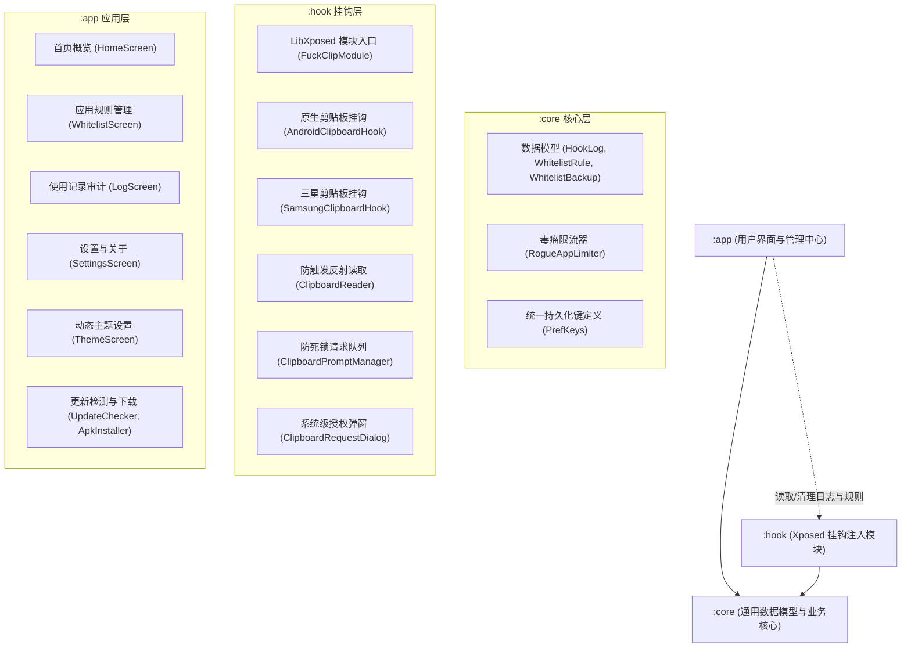

<div align="center">

# FuckClip

**新一代现代化 Android 剪贴板安全防护与隐私拦截 Xposed 模块**  
*A modern, powerful clipboard privacy & protection Xposed module for Android*

[](https://github.com/Cail-Gainey/FuckClip/actions/workflows/release.yml)
[](https://github.com/Cail-Gainey/FuckClip/actions/workflows/ci.yml)
[](LICENSE)
[-green.svg)](https://developer.android.com)
[](https://github.com/libxposed)

[简体中文](#简体中文) | [English](#english) | [更新日志](docs/CHANGELOG.md) | [贡献指南](docs/CONTRIBUTING.md) | [常见问题](docs/FAQ.md) | [架构设计](docs/ARCHITECTURE.md)

</div>

---

<span id="简体中文"></span>

## 项目简介

**FuckClip** 是一款基于现代 Android 技术栈（Kotlin 2.0、Jetpack Compose、Material 3、Koin）与 [LibXposed](https://github.com/libxposed)（API 102）重构的剪贴板隐私防护模块。

模块直接在 Android 系统服务级进程（`system_server`）中对系统剪贴板服务（`IClipboard`，包含原生 Android 与三星专有剪贴板服务）的 `setPrimaryClip()` 与 `getPrimaryClip()` 进行动态代理与拦截，帮助用户彻底杜绝各类应用未经授权静默扫描、窃取或污染剪贴板的行为。

---

## 核心特性

### 1. 读写双向独立控制
* **写入拦截 (Write Interception)**：默认触发询问弹窗。被拦截后可选择「允许并写入」，模块会在系统服务端自动补全该次写入动作。
* **读取拦截 (Read Interception)**：默认触发询问弹窗。被拒绝的应用只能读到空剪贴板；询问时本次读取同样被即时拦截。
* **记忆规则选择**：弹窗支持「记住此选择」，支持按应用独立配置三种策略：
  * **询问 (Ask)**：每次访问均弹出系统级授权对话框。
  * **允许 (Allow)**：白名单信任，直接放行读写。
  * **拒绝 (Deny)**：黑名单封禁，写入无效，读取返回空内容。

### 2. 毒瘤应用防死循环限流 (Rogue App Limiter)
针对部分应用被拒绝读取后在主线程死循环疯狂重试、导致屏幕弹窗频闪甚至系统响应迟缓的问题，设计了三大限频防护机制：
* **拒绝冷却期 (Deny Cooldown)**：用户在弹窗中选择拒绝后，在设定的冷却时间内（默认 5 秒），后续所有相同读取请求静默自动拦截，不再弹出弹窗。
* **允许突发窗口 (Grant Burst Window)**：用户选择放行后，在设定窗口期内（默认 2 秒），允许该应用的后续关联连续读取请求，保障部分多段读取应用的正常体验。
* **短时频次上限 (Rate Limit Threshold)**：3 秒内若连续读取尝试次数超过阈值（默认 10 次），自动限制后续请求。

### 3. 访问记录与隐私审计 (Audit Log)
* **全要素审计卡片**：完整记录应用名称、应用图标、操作方向（读取 / 写入）、规则放行状态（已允许 / 已拦截）与精确时间戳。
* **无感知内容预览**：在系统级拦截层直接通过反射读取剪贴板实际暂存内容进行预览（不调用外部 `getPrimaryClip()`），**不会触发 Android 系统自带的“已粘贴”通知气泡**。
* **详情弹窗与字符统计**：点击单条记录可查看完整剪贴板长文本、字符数统计，并支持一键重新复制。

### 4. 全动态主题系统 (Material You)
基于 Material 3 设计规范构建的外观配置系统：
* **四种色彩模式**：跟随系统、浅色模式、深色模式、AMOLED 纯黑模式。
* **动态壁纸取色 (Monet)**：在 Android 12+ 上完整支持根据用户桌面壁纸智能提取调色板。
* **双弧分割色块选择**：内置 5 种质感预设色系（湖水绿 Teal、经典蓝 Blue、紫罗兰 Violet、玫瑰粉 Rose、琥珀橙 Amber），呈现 Primary 与 Tertiary 双色容器交错质感。
* **调色算法定制**：支持切换 5 种 Material 3 色彩变体风格（Tonal Spot、Vibrant、Expressive、Neutral、Monochrome）。
* **悬浮底栏切换**：支持可选的悬浮胶囊底部导航栏。

### 5. 深度多语言国际化 (i18n)
* 完整支持 **English**、**简体中文 (zh-CN)** 与 **繁體中文 (zh-TW)**，209 个词条实现 100% 覆盖。
* 支持在设置界面中独立切换应用语言，也可直接跟随系统语言。
* **系统服务弹窗同步适配**：在 `system_server` 进程中弹出的授权询问对话框会智能读取应用内所选语言与主题颜色，保证系统级弹窗与主应用视觉风格完全统一。

### 6. 自动化更新与 CI/CD 发布
* **应用内在线更新**：自动检测 GitHub Releases 最新版本，显示版本更新日志与安装包体积，支持应用内流式下载并自动调起安装器。
* **Tag 驱动自动发布**：向仓库推送版本标签（如 `v1.0.0`）时，GitHub Actions 自动触发编译并发布 Release。
* **自动聚合两次版本间的 PR**：Release 说明自动提取自上个版本以来合并的所有 Pull Request 标题与贡献者明细。
* **免配置永久签名**：内置永久 28 年 Release 签名密钥库，无需配置任何 GitHub Secrets 即可由 CI 自动签署，确保所有发布的官方包签名完全一致，升级更新绝不冲突。

---

## 项目架构

本项目采用严格的高内聚、低耦合多模块组件化设计：



* **`:core`**：轻量级基础依赖层，无冗余 Android UI 依赖，包含通用数据模型、规则定义、毒瘤限频状态机及单元测试。
* **`:hook`**：纯粹的系统注入层，使用 LibXposed API 102，负责在 `system_server` 中进行反射拦截、IPC 队列调度与系统对话框渲染。
* **`:app`**：现代 Jetpack Compose 界面层，利用 Koin 进行单例依赖注入，状态全流式响应（StateFlow），保证所有组件遵循单一职责原则，单文件行数均维持在 500 行以内。

---

## 构建与编译

### 前置环境
* **JDK**：17（推荐 Temurin 17）
* **Android SDK**：API 35（Android 15）
* **Gradle**：8.14.3（使用自带的 `./gradlew` 包装器）

### 常用命令
```bash
# 1. 运行多语言一致性校验
python3 tools/check_translations.py

# 2. 运行所有模块的单元测试
./gradlew test

# 3. 编译 Debug 版本 APK
./gradlew assembleDebug

# 4. 编译并签署 Release 版本 APK（自动使用内置 release.jks 签名）
./gradlew assembleRelease
```
编译产物位于 `app/build/outputs/apk/` 目录下。

---

## 安装与激活

1. 确保设备已 Root 并安装 **LSPosed**（推荐使用最新支持 LibXposed 的 LSPosed 变体版本）。
2. 在 [Releases 页面](https://github.com/Cail-Gainey/FuckClip/releases) 下载最新的 `FuckClip-v*.apk` 并安装。
3. 打开 LSPosed Manager，在模块列表中找到 **FuckClip** 并勾选启用。
4. 作用域勾选 **系统框架 (System Framework / android)**。
5. 重启设备（或软重启系统框架）使挂钩生效。

---

## 文档与社区

欢迎查阅项目相关文档并参与贡献：
* [更新日志 (CHANGELOG.md)](docs/CHANGELOG.md)：版本里程碑与变更记录
* [常见问题与排查 (FAQ.md)](docs/FAQ.md)：高频问题答疑与故障排查
* [技术架构设计 (ARCHITECTURE.md)](docs/ARCHITECTURE.md)：系统层挂钩实现与组件架构
* [贡献指南 (CONTRIBUTING.md)](docs/CONTRIBUTING.md)：代码规范、单文件行数限制与提交规范
* [安全策略 (SECURITY.md)](docs/SECURITY.md)：漏洞报告与私密披露流程
* [行为准则 (CODE_OF_CONDUCT.md)](docs/CODE_OF_CONDUCT.md)：开源社区健康协作准则

---

## 开源协议与致谢

本项目基于 [MIT License](LICENSE) 开源。

* **原版作者**：[ablist97 (nlifew)](https://github.com/nlifew)
* **重构维护**：[Cail-Gainey](https://github.com/Cail-Gainey)
* **致谢开源项目**：
  * [LibXposed](https://github.com/libxposed) - 现代化 Xposed API 规范
  * [MaterialKolor](https://github.com/jordond/MaterialKolor) - 强大的 Compose 动态色彩生成库
  * [Koin](https://insert-koin.io/) - 优雅轻量的 Kotlin 依赖注入框架

---

<span id="english"></span>

## Introduction (English)

**FuckClip** is an advanced Android clipboard privacy protection and access management module completely re-engineered on top of Kotlin 2.0, Jetpack Compose, Material 3, and [LibXposed](https://github.com/libxposed) (API 102).

It dynamically intercepts `setPrimaryClip()` and `getPrimaryClip()` directly inside `system_server` for both AOSP and Samsung clipboard services, stopping rogue applications from silently monitoring, stealing, or polluting your clipboard.

### Key Highlights
- **Bi-directional Permission Control**: Configurable per-app policies for both *Write* and *Read* (Ask, Allow, Deny).
- **Rogue App Throttle Engine**: Intelligent anti-loop protection featuring *Deny Cooldown*, *Grant Burst Window*, and *Rate Limit Threshold*.
- **Privacy Audit Log**: Complete history logs with app icons, directional pills, formatted previews, and one-click copy.
- **Dynamic Material You Theme**: Features Monet wallpaper extraction, 5 vibrant preset seeds, AMOLED black, and customizable variant styles.
- **Deep Localization (i18n)**: 100% coverage across English, Simplified Chinese, and Traditional Chinese with in-app language switching and themed system server authorization prompts.
- **Automated CI/CD**: Seamless tag-driven GitHub Releases with automated PR changelog aggregation and built-in permanent APK signing.

### Documentation
- [Changelog (docs/CHANGELOG.md)](docs/CHANGELOG.md): Version milestones and release notes.
- [FAQ & Troubleshooting (docs/FAQ.md)](docs/FAQ.md): Common problems, activation help, and Samsung support.
- [Architecture (docs/ARCHITECTURE.md)](docs/ARCHITECTURE.md): In-depth system hook and component architecture.
- [Contributing (docs/CONTRIBUTING.md)](docs/CONTRIBUTING.md): Coding guidelines, line limit standards, and PR workflows.
- [Security Policy (docs/SECURITY.md)](docs/SECURITY.md): Responsible vulnerability reporting channels.
- [Code of Conduct (docs/CODE_OF_CONDUCT.md)](docs/CODE_OF_CONDUCT.md): Community standards and pledge.

### License
FuckClip is released under the [MIT License](LICENSE).
