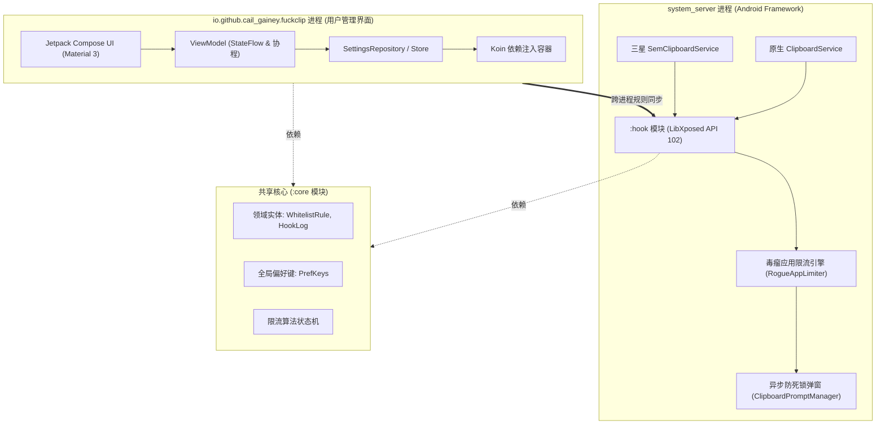

# 技术架构与设计原理 (Technical Architecture)

本文档深入解析 FuckClip 的系统级挂钩机制、分层架构与核心设计决策。

[English Version Below](#english-version)

---

## 整体架构视图

FuckClip 采用高内聚、低耦合的多模块组件化设计：

---

## 模块分层职责

### 1. `:core` 模块（通用基础与领域模型）
- **定位**：纯 Kotlin/Android 基础模型与纯算法库，不包含任何 UI 与 Xposed 框架依赖。
- **核心组件**：
  - `WhitelistRule`：三态规则实体，定义 `REQUEST`（询问）、`DENY`（拒绝）、`GRANT`（允许）。
  - `HookLog`：审计记录实体，记录调用包名、时间戳、操作类型（READ / WRITE）及处理结果。
  - `RogueAppLimiter`：滑动时间窗口频次限流器，基于环形时间队列维护调用频次。
  - `PrefKeys`：集中管理跨进程共享的键名。

---

### 2. `:hook` 模块（系统层挂钩实现）
- **定位**：工作在 Android 核心系统进程 `system_server` 中，基于 LibXposed API 102 现代标准。
- **挂钩拦截策略**：
  - **原生 AOSP 服务**：挂钩 `com.android.server.clipboard.ClipboardService` 的 `getPrimaryClip`、`setPrimaryClip` 等核心 Binder 接口。
  - **三星定制服务**：挂钩 `com.samsung.android.content.clipboard.SemClipboardService` 等专有接口。
- **内部安全读取与反射代理**：
  - 为在弹出授权对话框前向用户呈现剪贴板预览内容，Hook 层直接通过底层内部变量或反射获取数据，避免重入再次触发外部审计监听器。
- **异步安全调度与防死锁设计**：
  - `system_server` 的 Binder 线程资源极其宝贵，不可长时间阻塞。
  - 挂钩拦截请求后，将任务封装为 `PendingRequest`，通过主线程 Looper 或专用 Handler 异步拉起授权对话框。
  - 设置严格的响应超时机制（Safety Timeout），超时未响应时安全降级返回，彻底杜绝系统主服务挂起或软重启风险。

---

### 3. `:app` 模块（现代化用户界面）
- **定位**：用户配置与监控审计中心，采用现代 Android 全技术栈构建。
- **核心特性**：
  - **Jetpack Compose + Material 3**：全面响应式 UI，无遗留 XML 布局依赖。
  - **动态主题引擎**：支持跟随系统的动态调色板（Dynamic Color）及多种调色风格（Tonal Spot、Neutral、Vibrant、Expressive、Monochrome）。
  - **单向数据流 (UDF)**：通过 `StateFlow` 与 `SharedFlow` 驱动 UI 重组，状态清晰无副作用。
  - **组件化轻量单文件**：所有界面拆分为独立的卡片、对话框与组件子文件，严格控制单文件在 500 行以内。

---

## English Version

### Architecture Overview

FuckClip is structured into three distinct modules to ensure separation of concerns and maintainability:

1. **`:core`**: Pure domain models and algorithm components. Contains `WhitelistRule`, `HookLog`, `RogueAppLimiter`, and shared constants. Does not depend on Android UI or Xposed libraries.
2. **`:hook`**: LibXposed API 102 implementation injected into `system_server`. Intercepts clipboard read/write events across AOSP and Samsung ClipService instances, parses data via internal reflection proxies, and dispatches UI requests via an asynchronous deadlock-free queue.
3. **`:app`**: Modern Jetpack Compose & Material 3 application. Powered by Koin dependency injection, StateFlow state machines, dynamic theming palettes, and robust JSON backup/restore tools.
